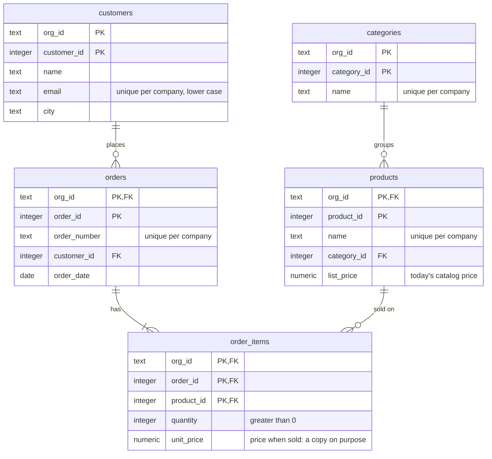

# Step 05 notes: Relational databases and normal forms with Neon

**Live MCP URL:** _TODO: https://learn-mcp-step-05.stockroom-mms.workers.dev/mcp, once deployed_

The step 04 server, with its notes in Workers KV replaced by a sales database in Neon Postgres. Auth stays in D1 (its own database for this step, `learn-mcp-auth-step-05`).

## Where things are

| What | Where |
| --- | --- |
| Neon project and branches | Project `stockroom`; branch `step-05` (from `production`) for this step, and `dev` (from `step-05`) to experiment on |
| Migrations | `db/migrations/NNNN_*.sql`, applied by `npm run db:migrate -- --branch <branch>` (`db/migrate.ts`), recorded in `public.schema_migrations` |
| Running a query file | `npm run db:sql -- --branch dev <file.sql>` (`db/sql.ts`) |
| Copying the sample sales into a company | `npm run db:seed -- --branch <branch> --org <organization ID>` (`db/seed-company.ts`) |
| The spreadsheet's anomalies | `db/queries/flat-sales-anomalies.sql` |
| Checks on the normalized design | `db/queries/normalized-checks.sql` |

## The flat spreadsheet (migration 0001)

`staging.flat_sales` is a wholesale distributor's sales from 1 December 2025 to 27 November 2026 as one spreadsheet: 428 rows, one per order line, for 169 orders, 14 customers and 18 products. Every row repeats the customer's name, email and city and the product's name, category and price. It came with the problems such a sheet always has:

- **Several values in one cell:** 7 rows hold two products, with two categories, two prices and two quantities (`"Rolled Oats 1kg, Kettle Chips 150g"`, `"4.29, 2.49"`). Price and quantity had to be text, and `sum(unit_price * quantity)` fails.
- **Update anomaly:** Corner Market moved from Austin to Round Rock in June. The city is typed on every row, and some later rows were copied from old ones, so the sheet says Austin on 47 rows (the last on 31 October) and Round Rock on 17. Which is right? The data can't say. Bluebonnet Grocers' email is typed two ways (38 and 30 rows), and Trail Mix is filed under Snacks on 17 rows and Pantry on 5. Renaming Kettle Chips means finding every row that sold it; a rename limited to this year left the product with three spellings.
- **Insert anomaly:** a row is an order line, so a new product nobody has bought yet (Coconut Water) has nowhere to go: the insert fails on `order_number`. Nor does a new customer who hasn't ordered.
- **Delete anomaly:** Old Town Grocer placed one order, the only sale of the bulk olive oil. Cancelling it deletes the customer and the product too: nothing remembers they exist.

## First normal form (migration 0002)

**The rule.** Each cell holds one value, there are no repeating groups, and each row is identified by a key.

**What broke it.** The 7 rows with two products in `product_name`, `category`, `unit_price` and `quantity`.

**The fix.** `staging.sales_1nf` splits each list into one row per product (`unnest` walks the four lists side by side) and gives price and quantity real types (`numeric(10,2)`, `integer`). The key is `(order_number, product_name)`. 428 rows become 435 lines. Customer and product details are still repeated: 1NF doesn't address that.

## Second normal form (migration 0003)

**The rule.** With a key of more than one column, every other column depends on the whole key, not part of it.

**What broke it.** With the key `(order_number, product_name)`:

- `order_date`, `customer_name`, `customer_email` and `customer_city` depend on `order_number` alone (facts about the order);
- `category` depends on `product_name` alone (a fact about the product);
- only `unit_price` and `quantity` need both: how many of this product on this order, at what price.

**The fix.** Three tables: `staging.orders_2nf` (key `order_number`), `staging.products_2nf` (key `product_name`) and `staging.order_lines_2nf` (key `(order_number, product_name)`). Splitting forced a choice where the copies disagreed: a product has one category (Trail Mix: Snacks, the one most lines used) and one list price (the price on its latest sale).

## Third normal form (migration 0004)

**The rule.** No column depends on another non-key column; each fact is stored once, in the table about the thing it describes.

**What broke it.** In `orders_2nf` (key `order_number`), `customer_email` and `customer_city` depend on `customer_name`, which isn't the key. They're facts about the customer, copied onto each order, which is exactly how Corner Market ended up in two cities.

**The fix.** The final tables, in the `public` schema: `customers`, and `orders` that point at a customer instead of copying them. `categories` became a table too. Strictly, a category name alone doesn't break 3NF, but a category is something Stockroom manages (rename it once, keep a fixed list), and a foreign key stops a product being filed under a misspelling. The choices forced here: emails are lower-cased (a `CHECK` keeps them so), and a customer's city is the one on their latest order (Corner Market: Round Rock).

**The copy kept on purpose.** `order_items.unit_price` repeats the product's price, which 3NF would normally remove. It's kept because it is a different fact: the price this line was sold at. Olive Oil 1L sold at 11.99 on 8 lines before June and 12.99 on 11 lines after; its list price is now 12.99. Working out old orders from today's price would change revenue already earned and invoiced.

**Each row belongs to a company.** Every table has `org_id`, the organization ID from the auth database: the company the signed-in user chose, which reaches the server only inside the verified token. `org_id` is part of every primary key (`(org_id, order_id)`) and every foreign key (`(org_id, customer_id) REFERENCES customers (org_id, customer_id)`), so a row can only point at rows of its own company. An order line for another company that names the demo company's order 1 is refused by the foreign key. The sample data belongs to a demo company, `org_id = 'demo'`, which isn't an organization in D1, so nobody can sign into it; `npm run db:seed` copies it into a real company.

**Constraints.** `NOT NULL` on every column. `CHECK`: `quantity > 0`, prices `>= 0`, names 1 to 50 or 100 characters, emails lower-case with an `@`. `UNIQUE` within a company: category and product names, customer emails, order numbers. Foreign keys: products to categories, orders to customers, order lines to orders (deleting an order deletes its lines) and to products (a product that has been sold can't be deleted).

**What it fixed** (`db/queries/normalized-checks.sql`, on the `dev` branch). Nothing lost: 435 lines, and revenue of 37,742.41 in both the spreadsheet (merged cells split) and the final tables. Each customer has one city and one email, and Trail Mix one category. Renaming Kettle Chips is one row, and all 20 lines that sold it show the new name. Coconut Water can be added with no order. Cancelling Old Town Grocer's order leaves the customer and the bulk olive oil in place.

## Cleaning up (migration 0005)

The 1NF and 2NF tables were steps on the way, not part of the design: 0004 copied the data out of them, and nothing reads them afterwards. Migration 0005 drops them, so the demo sales exist once. Migrations 0002 and 0003 stay unchanged as the record of each step (a migration that has run is never edited), and a fresh branch still builds and then drops them. `staging.flat_sales` stays, for `compare_designs`.

## ER diagram

Every relationship is within one company: each foreign key includes `org_id`.

## What each client showed

_TODO, after deploying: the schema explained, a business question answered, and the "two cities" question, in Claude (`claude.png`) and ChatGPT (`chatgpt.png`)._
